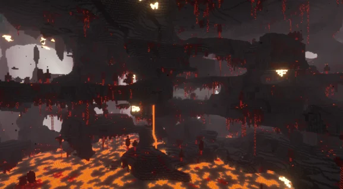

###  Ash Barrens

The Ash barrens are old lava lakes and coast now covered by ashes after Piglins destroyed this land to build their Forbidden castles. Some trees have now regrown on some hilly part of the area, but the flat, covered lava lakes, make you an easy target if you dare to come close to a Forbidden castle.

## Gallery

