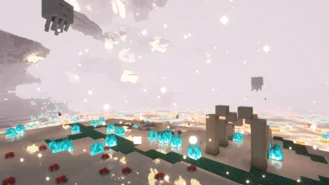

# Quartz Flats

The Quartz flats are mirage biomes full of quartz, floating on the lava seas. This biome, considered cold even for the Nether, are the home of Ghasts, who seem to thrive in these temperatures and open lands, although they are not the only inhabitants of the biome. The Quartz kitchen can be found around the lava seas, full of Skeletons, unafraid to fall in the lava and imprisoned Ghastlings. A massive structure, the Sanctum, can also be found here, home of strong Pillagers that managed to get into the Nether...

## Gallery

