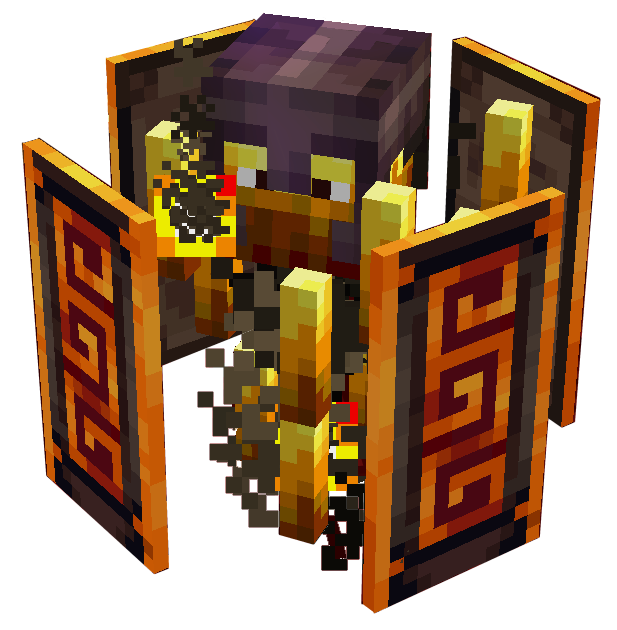

# Hovering Inferno


!!! tip inline end "Hovering Inferno"

    
    === "Hovering Inferno"
        {.center}


        

    __Base Mob:__     Blaze  
    __Health:__  700 (350 {width="9"})
    
    __Health Bonus:__  + 200 (100 {width="9"}) per additional player  
    __Attack Damage:__  [INSERT] ({width="9"} x 3) - 7 ({width="9"} x 3.5)  
    __Loot:__  [Infernal Key](https://stardust-labs-mc.github.io/incendium-wiki/items/infernal-key/)
    
    __Death XP:__  [INSERTHERE]
    > ``` mcf title="Summon Command"
      [INSERT]
      ```

The **Hovering Inferno** is the challenging, flagship  boss of Incendium, summoned by sacrificing an [Infernal Charm](https://stardust-labs-mc.github.io/incendium-wiki/items/infernal-charm/) at an [Infernal Altar](https://stardust-labs-mc.github.io/incendium-wiki/structures/infernal-altar/). The boss consists of 2 phases of both randomized and sequenced boss patterns, as well as player influenced behavior. 

