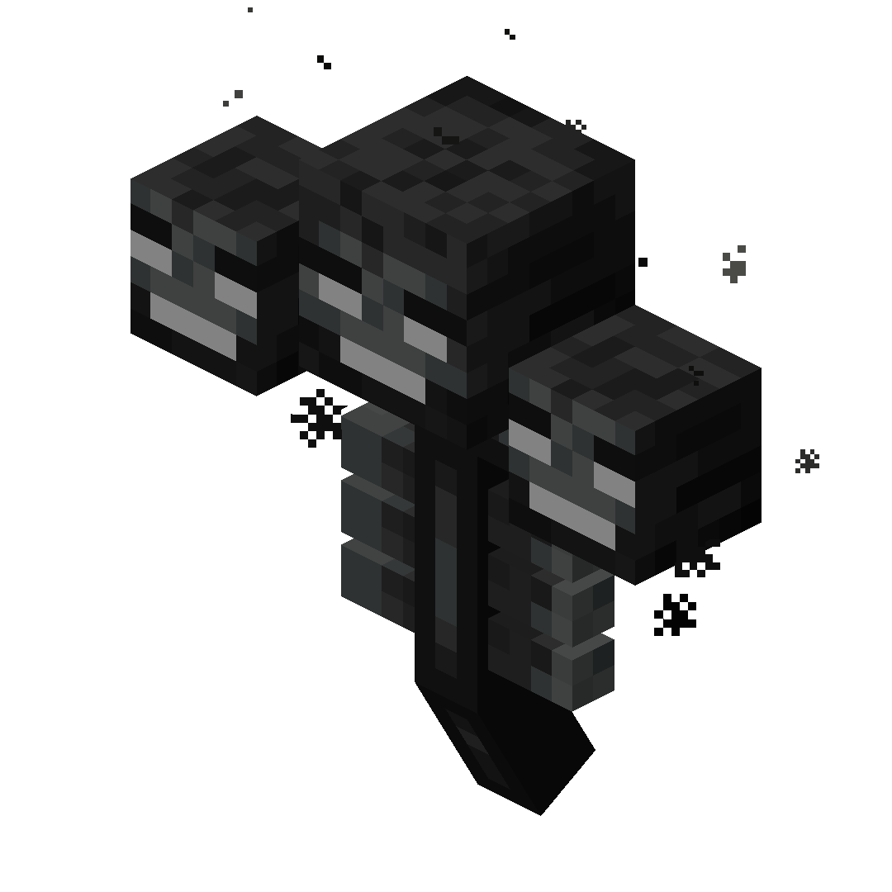

# Warped Wither


!!! tip inline end "Warped Wither"

    
    {width="196"}

    __Base Mob:__     Wither  
    __Health:__  800 (400 {width="9"})  
    __Size Scale:__  1.5  
    __Loot:__  [Warping Witherblade](../items/warping-witherblade.md)  
    > ``` mcf title="Summon Command"
      function incendium:admin/summon/warped_wither
      ```


# Description

The __Warped Wither__ is a buffed up version of the base Wither added by Incendium. The boss takes inspiration from the Bedrock wither's harder fight. When it is summoned, all players nearby will recive the Withering Depths advancement.

Upon being slain the Warped Wither will drop the [Warping Witherblade](../items/warping-witherblade.md) and a nether star

# Spawning

The boss can be summoned by creating a Wither in the Nether while under the effects of Bad Omen or Trial Omen, if under the effect of the former then it will be converted into Trial Omen upon the summoning.