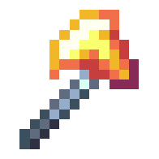

### Description


!!! tip inline end "Blazing Hatchet"

    
    {.center}


    __Base Item:__     Netherite Axe  
    __Durability:__  2031  
    __Attack Damage:__  9 ({width="9"} x 4.5)  
    __Attack Speed:__  0.7  
    __Minimum Attack Charge:__  0.6  
    __Knockback:__  2.3  
    __Fire:__  Yes  
    > ``` mcf title="Give Item Command"
      function incendium:admin/give/blazing_hatchet
      ```


## Description

The Blazing Hatchet is an axe that holds explosive force on impact

When striking a foe they will be lit on fire for 5 seconds and it will create fiery explosion at the struck target, the explosion will cause foes in an area to take 6 ({width="9"} x 3)'s of damage, knockback and be lit on fire for 3 seconds. (_Due to technical limitations, fire from the explosion only effects mobs_). This explosion has a 2 second cooldown. While the damage and fire from the explosion don't effect the user the knock back does, allowing for users to get a jump boost from hitting foes if they are close enough.

When mining logs using the Blazing Hatchet the logs will be turned into charcoal

This item is immune to burning in lava/explosions and most other means of destroying items


## Obtaining

The Blazing Hatchet spawns at the [Forbidden castle](../structures/forbidden-castle.md) inside Pyro rooms.


## Modifications
This item can be renamed without losing its effect, but it will lose its font color. This can be restored by reseting it's name at an anvil. It can also be grindstoned safely

The Blazing Hatchet works with any axe enchantment but can not be enchanted directly, you must combine enchant books in order to add any enchants
