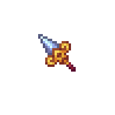

!!! tip inline end "Dawnlight"

    === "Held Sprite"
        {width="196"}

    === "GUI Sprite"
        {width="196"}
    
    
    __Base Item:__     Netherite Spear  
    __Item Model:__     Iron Spear  
    __Durability:__  2031  
    __Attack Damage:__  7 ({width="9"} x 3.5)  
    __Projectile Damage:__  6 ({width="9"} x 3)  
    __Attack Speed:__  0.7  
    __Minimum Attack Charge:__  1  
    > ``` mcf title="Give Item Command"
      function incendium:admin/give/dawnlight
      ```


## Description

Dawnlight is a holy spear that launches spectral swords at foes that explode on impact

Upon jabbing with the spear it will create a glowing sword that moves foward the direction you aim until it either hits a block/entity or after 8 blocks traveled then it explodes. The explosion does 3{width="9"}'s of damage to entities in a 2.5 block range. This explosion gains extra damage based on the damage enchants of the users spear and works with specfic damage enchants like smite. The sword sent launched by the spear has a 6 second cooldown.

This spear is not able to be used as a jousting weapon but it means this weapons can be used alongside other offhand items like shields, bows or food.

This weapon has synergy with the Item [Prismatica](../items/prismatica.md), if there is a Prismatic Sword charge ready then whenever you jab with the spear you will use on up and summon a Prismatic Sword and launch it towards the direction your facing. While holding both [Prismatica](../items/prismatica.md) and Dawnlight the Prismatic Sword charges for [Prismatica](../items/prismatica.md) will charge up at double the speed.


This item is immune to burning in lava/explosions and most other means of destroying items

## Obtaining

The Dawnlight is obtained from the [Pipeline](../structures/pipeline.md) and can be found rarely sticking out of some rubble sittning in the lava in the large pipes.

## History

The Dawnlight is a Patron item requested by Crashcringle.

## Modifications
This item can be renamed without losing its effect, but it will lose its font color. This can be restored by reseting it's name at an anvil. It can also be grindstoned safely

The Dawnlight works most spear enchantments except lunge and can not be enchanted directly, you must combine enchant books in order to add any enchants
