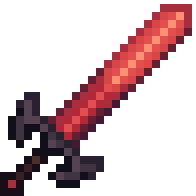
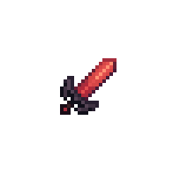

!!! tip inline end "Greatsword of Sacrifice"

    
    === "Held Sprite"
        {.center}

    === "GUI Sprite"
        {.center}

    __Base Item:__     Netherite Sword  
    __Durability:__  2031  
    __Attack Damage:__  19 ({width="9"} x 9.5) - 21 ({width="9"} x 10.5)  
    __Attack Speed:__  0.7  
    __Minimum Attack Charge:__  0.75  
    __Disables Blocking:__  Yes, 2s  
    > ``` mcf title="Give Item Command"
      function incendium:admin/give/greatsword_of_sacrifice
      ```


## Description

This is a heavy but powerful sword that does a lot of damage in exchange for reoil damage on the user.

The recoil damage is based off your current health including Absorption health, with the less health you have the less recoil you will take. The recoil damage is true damage and can not be negated by any means, however you will not take knockback from it either and the recoil will not apply if the damage was blocked. The scale is 20% of your current health rounded up, the damage will change depending on if the user has strength or weakness, weakness will rdeuce the percentage by 10 while strength will increase it by 10.

This item is immune to burning in lava/explosions and most other means of destroying items

## Obtaining

The Greatsword of sacrifice has a 50% chance of spawning on the top level of the main tower in the [Forbidden castle](../structures/forbidden-castle.md).

When obtaining the item it will have a random attack value from a full number range of 19-21


## Modifications
This item can be renamed without losing its effect, but it will lose its font color. This can be restored by reseting it's name at an anvil. It can also be grindstoned safely

The Greatsword of sacrifice works with any sword enchantment but can not be enchanted directly, you must combine enchant books in order to add any enchants
