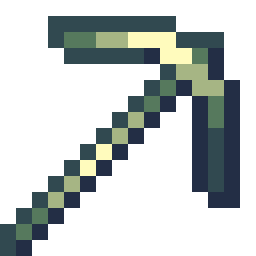

!!! tip inline end "Hefty Pickaxe"

    
    {width="196"}

    __Base Item:__     Netherite Pickaxe  
    __Durability:__  4062  
    > ``` mcf title="Give Item Command"
      function incendium:admin/give/hefty_pickaxe
      ```


## Description

Hefty Pickaxe is a Nether oriented excavator designed to help players mine away in the depths of the nether with staggering speed

The pickaxe gains mining speed the lower in the nether you are:
    - From Y 97 and up you get a 0.6 Block Break Speed Boost
    - From Y 96 - 65 you get a 1 Block Break Speed Boost
    - From Y 64 - 33 you get a 2.5 Block Break Speed Boost
    - From Y 32 - 17 you get a 3.8 Block Break Speed Boost
    - From Y 16 and below you get a 5.5 Block Break Speed Boost


This item is immune to burning in lava/explosions and most other means of destroying items

## Obtaining

The Hefty pickaxe can be found on an armor stand in the 2x1 blacksmith room, which has a chance to generate in the [Forbidden castle](../structures/forbidden-castle.md).


## Modifications
This item can be renamed without losing its effect, but it will lose its font color. This can be restored by reseting it's name at an anvil. It can also be grindstoned safely

The Hefty Pickaxe works most pickaxe enchantments except efficiency and can not be enchanted directly, you must combine enchant books in order to add any enchants
