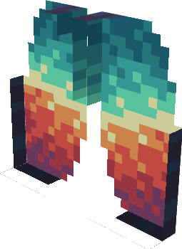

### Description


!!! tip inline end "Infernal Wings"

    
    === "GUI Sprite"
        {width="196"}

    === "Tattered GUI Sprite"
        {width="196"}

    === "Equipment Model"
        {width="196"}

    __Base Item:__     Elytra  
    __Durability:__  432  
    __Armor:__  6 ({width="9"} x 3)  
    __Armor Toughness:__  1 ({width="9"} x 3)  
    __Movement Speed:__  -5%  
    __Burning Time:__  -33%  
    > ``` mcf title="Give Item Command"
      function incendium:admin/give/infernal_wings
      ```


## Description

The Infernal Wings are an Elytra with an armor boost, making you able to fly with more armor at the cost of a 5% speed loss when flying and walking.

This item is immune to burning in lava/explosions and most other means of destroying items

## Obtaining

The Infernal Wings are upgraded from Tattered Infernal Wings which are obtained from a vault in the [Infernal Altar](../structures/infernal-altar.md) using an [Infernal Key](infernal-key.md)

## Tattered Infernal Wings

The Tattered Infernal Wings are the item you obtain before being combined with an Elytra to create the Infernal Wings. They are exactly the same as the Infernal Wings except you can't fly with them. They can be worn and provide their stats. 

## Modifications
This item can be renamed without losing its effect, but it will lose its font color. This can be restored by reseting it's name at an anvil. It can also be grindstoned safely

The Infernal Wings works with any elytra enchantment
