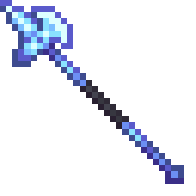
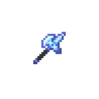

## Permafrost Pike


!!! tip inline end "Permafrost Pike"

    
    === "Held Sprite"
        {.center}

    === "GUI Sprite"
        {.center}

    __Base Item:__     Netherite spear  
    __Durability:__  2031  
    __Attack Damage:__  6 ({width="9"} x 3)  
    __Attack Speed:__  0.6  
    __Minimum Attack Charge:__  1  
    __Friction:__  -1  
    > ``` mcf title="Give Item Command"
      function incendium:admin/give/permafrost_pike
      ```


# Description

The Permafrost Pike is an all rounder weapon with a specialty keeping your distance and slaying Heat based mobs. 

Attacks from this spear do freezing based damage, which does 5x damage aganist Blazes, Magma Cubes and Striders. While doing half damage to Strays, Polar Bears and Snow Golems. It should be noted that againist the [Hovering Inferno](https://stardust-labs-mc.github.io/incendium-wiki/bosses/hovering-inferno/) the damage bonus will only be 1.5x.

Jabs from this weapon will create a snowball which will be launched in the direction you jab

While holding this weapon you turn water to ice similar to frost walker and will be under the effects Ice physics no matter what block your standing on.

When striking a foe two things will happen, first you will always give them slowness 1 for 2-3 seconds. Second is you will apply the Frozen effect, this will give the foe slowness 5 for 1 second and create a visual of the foe being encased in a large ice block breifly, this effect has a 6 second cool down


This item is immune to burning in lava/explosions and most other means of destroying items

# Obtaining

The Permafrost Pike can be found in a barrel in he 1x2 Freezer Room inside the [Forbidden castle](../structures/forbidden-castle.md). Or rarely in a copper chest inside the [Ruined Lab](../structures/ruined-lab.md) in the bottem floor inside a Freezer Section


# Modifications
This item can be renamed without losing its effect, but it will lose its font color. This can be restored by reseting it's name at an anvil. It can also be grindstoned safely

The Permafrost Pike works with most spear enchantments except fire aspect and knockback and can not be enchanted directly, you must combine enchant books in order to add any enchants
