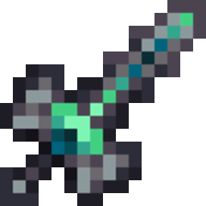

## Warping Witherblade


!!! tip inline end "Warping Witherblade"

    
    {width="196"}

    __Base Item:__     Netherite sword  
    __Durability:__  2031  
    __Attack Damage:__  12 ({width="9"} x 6)  
    __Attack Speed:__  0.7  
    __Minimum Attack Charge:__  0.8  
    __Movement Speed:__  -15% - -22.5%  
    > ``` mcf title="Give Item Command"
      function incendium:admin/give/warping_witherblade
      ```


# Description

Warping Witherblade is a slow but strong heavy that can apply wither on hit or be used to block to reduce damage taken and release a wither effect on nearby foes

When striking foes with this sword there is a 33% chance to apply wither{width="9"} 2 for 3 seconds

The sword is capable of blocking but not like a shield, when blocking you will redice the damage of incoming melee attacks by 25% and will be unable to block ranged attacks. However on block you release an area of effect wither cloud to give wither{width="9"} 1 for 7 seconds to nearby foes in a 4.5 block radius. This block attack has a cooldown of 6.

Slaying mobs with this sword gives twice the experince.

This item is immune to burning in lava/explosions and most other means of destroying items

# Obtaining

The Warping Witherblade is dropped by a boss the [Warped Wither](../bosses/warped-wither.md)

When obtaining the item it will have a random movement speed value from -15% to -22.5% in segments of 2.5% between the two.


# Modifications
This item can be renamed without losing its effect, but it will lose its font color. This can be restored by reseting it's name at an anvil. It can also be grindstoned safely

The Warping Witherblade works all sword enchantments but can not be enchanted directly, you must combine enchant books in order to add any enchants
